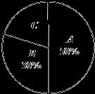

# Mathematics (Grade 6)

**ID**: ac9e4333
**难度**: medium_hard
**题型**: multiple_choice

## 题目
小丽用50元钱购买A、B、C三种物品（如图）她购买B物品比购买C物品多用了（）元。

$\begin{description}
\item A．5\item B．10\item C．25\item D．15
\end{description}$

## 解答

**答案**: A

1. Step1:计算购买C物品的钱数占总钱数的百分比，由1 - 50% - 30% = 20%可得
2. Step2:计算购买B物品比购买C物品多用的钱数占总钱数的百分比，即30% - 20% = 10%
3. Step3:计算购买B物品比购买C物品多用的钱数，50×10% = 5元
4. Step4:得出答案为A

## 知识点

**知识点**:
  - 小学数学;统计和概率;统计;统计图;扇形统计图的特点及绘制

---
