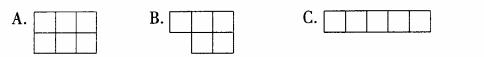

# Mathematics (Grade 6)

**ID**: afa35e3b
**难度**: medium_hard
**题型**: multiple_choice

## 题目
下面的图形中，周长最长的是（）

## 解答

**答案**: C

1. Step1:明确需要比较三个图形的周长，依据周长的意义，通过数由多少个小正方形边长组成来确定周长
2. Step2:数出A图形周长是由10个小正方形边长组成
3. Step3:数出B图形周长是由10个小正方形边长组成
4. Step4:数出C图形周长是由12个小正方形边长组成
5. Step5:比较三个图形周长包含小正方形边长的个数，12＞10，得出C图形周长最大，答案为C

## 知识点

**知识点**:
  - 周长的认识

---
