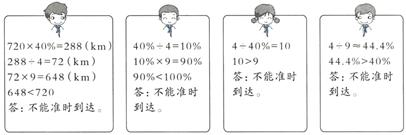

# Mathematics (Grade 6)

**ID**: b19f4987
**难度**: medium_hard
**题型**: multiple_choice

## 题目
一辆汽车要用9时赶往距离学校720 km的营地接军训的学生，已知前4时行了全程的40%，照这样的速度，能准时到达吗？下面有4位同学的解答方法，你认为有(    )位同学的解答方法是合理的。

A．1
B．2
C．3
D．4

## 解答

**答案**: D

1. Step1:分析第一位同学的方法，先算出前4时行驶的路程为720×40% = 288(km)，再算出速度为288÷4 = 72(km/h)，按照此速度9时行驶的路程为72×9 = 648(km)，因为648<720，所以不能准时到达，该方法合理。
2. Step2:分析第二位同学的方法，先算出40%÷4 = 10%，即1时行驶全程的10%，那么9时行驶全程的10%×9 = 90%，因为90%<100%，所以不能准时到达，该方法合理。
3. Step3:分析第三位同学的方法，4÷40% = 10(时)，即行驶完全程需要10时，因为10>9，所以不能准时到达，该方法合理。
4. Step4:分析第四位同学的方法，9÷4 = 2.25，40%×2.25 = 90%，9时行驶全程的90%，因为90%<100%，所以不能准时到达，该方法合理。
5. Step5:综上，4位同学的解答方法都合理，答案选D。

## 知识点

**知识点**:
  - 小学数学;数与代数;应用题;百分数应用题;百分数复合应用题

---
