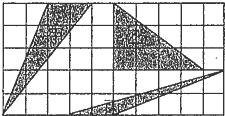

# Mathematics (Grade 6)

**ID**: b1bcb9cf
**难度**: medium_hard
**题型**: multiple_choice

## 题目
如图所示，小正方形的边长为1，三个三角形中面积最大的是(  )
A．甲
B．乙
C．丙

## 解答

**答案**: B

1. Step1:根据小正方形边长为1，确定甲三角形的底为2，高为2
2. Step2:根据三角形面积公式S = 底×高÷2，计算甲三角形面积为2×2÷2 = 2
3. Step3:根据小正方形边长为1，确定乙三角形的底为3，高为4
4. Step4:根据三角形面积公式S = 底×高÷2，计算乙三角形面积为3×4÷2 = 6
5. Step5:根据小正方形边长为1，确定丙三角形的底为2，高为5
6. Step6:根据三角形面积公式S = 底×高÷2，计算丙三角形面积为2×5÷2 = 5
7. Step7:比较三个三角形面积大小，2＜5＜6，得出乙三角形面积最大
8. Step8:所以答案选B

## 知识点

**知识点**:
  - 面积及面积的大小比较．

---
