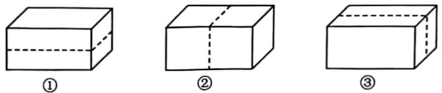

# Mathematics (Grade 6)

**ID**: b2d4c461
**难度**: medium_hard
**题型**: multiple_choice

## 题目
把一个长12厘米、宽6厘米、高7厘米的长方体切成两个小长方体。下面三种切法中，表面积增加最多的是（    ）。 

$\begin{description}
\item A.①\item B.②\item C.③\item D.无法判断
\end{description}$

## 解答

**答案**: C

1. Step1:明确将长方体切成两个小长方体，增加的表面积是两个切面的面积
2. Step2:计算第①种切法增加的表面积为12×6×2 = 144平方厘米
3. Step3:计算第②种切法增加的表面积为6×7×2 = 84平方厘米
4. Step4:计算第③种切法增加的表面积为12×7×2 = 168平方厘米
5. Step5:比较三种切法增加的表面积大小，168＞144＞84，得出第③种切法表面积增加最多

## 知识点

**知识点**:
  - 

---
