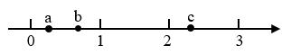

# Mathematics (Grade 6)

**ID**: b47c52f8
**难度**: medium_hard
**题型**: multiple_choice

## 题目
a、b、c在数轴上的位置如图所示，下面式子中结果与c最接近的是（    ）。 

$\begin{description}
\item A.b＋a\item B.b－a\item C.b×a\item D.b÷a
\end{description}$

## 解答

**答案**: D

1. Step1:根据a、b、c在数轴上的位置，确定取值范围为0＜a＜b＜1，2＜c
2. Step2:假定a＝0.3，b＝0.7
3. Step3:计算选项A，b＋a＝0.3＋0.7＝1
4. Step4:计算选项B，b－a＝0.7－0.3＝0.4
5. Step5:计算选项C，b×a＝0.7×0.3＝0.21
6. Step6:计算选项D，b÷a＝0.7÷0.3≈2.3
7. Step7:比较1、0.4、0.21、2.3与c所在范围2＜c的接近程度，发现2.3最接近c，所以结果与c最接近的是b÷a，答案为D

## 知识点

**知识点**:
  - 

---
