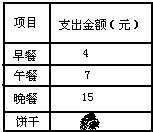

# Mathematics (Grade 6)

**ID**: b5ebd517
**难度**: medium_hard
**题型**: multiple_choice

## 题目
小明某天记录的支出如图所示，不小心饼干的支出金额被墨水污染了，如果小明原来有30元，每包饼干的售价为1.3元，那么小明剩下的钱数不可能是（  ）
$\begin{description}
\item A．0.1元\item B．0.8元\item C．1.4元\item D．2.7元
\end{description}$

## 解答

**答案**: B

1. Step1:先计算出除饼干外其他支出的总金额，4 + 7 + 15 = 26元
2. Step2:用原有的30元减去其他支出的总金额，得到饼干可支出的金额，30 - 26 = 4元
3. Step3:计算4元能买几包饼干及剩余多少钱，4÷1.3 = 3（包）…0.1（元）
4. Step4:计算买2包饼干后剩余的钱数，4 - 1.3×2 = 1.4元
5. Step5:计算买1包饼干后剩余的钱数，4 - 1.3 = 2.7元
6. Step6:对比选项，得出小明剩下的钱数不可能是0.8元

## 知识点

**知识点**:
  - 整数、小数复合应用题．

---
