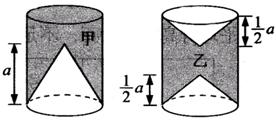

# Mathematics (Grade 6)

**ID**: b622fd3a
**难度**: medium_hard
**题型**: multiple_choice

## 题目
用两根完全相同的圆柱形木料分别制作成右图中的两个模型（图中涂色部分），甲与乙的体积相比（  ）
A．甲大
B．乙大
C．相等

## 解答

**答案**: C

1. Step1:明确圆锥体积公式为V = 1/3×S×h（V是圆锥体积，S是底面积，h是高）
2. Step2:根据圆锥体积公式，当底面积S相同时，两个高为1/2 a的圆锥体积之和为2×(1/3×S×1/2 a)=1/3×S×a，即等于一个高为a的圆锥的体积
3. Step3:因为两根圆柱形木料完全相同，所以原来两个圆柱的体积相等
4. Step4:由前面分析可知甲和乙中空白处图形（圆锥）的体积相等
5. Step5:根据圆柱体积 = 涂色部分体积 + 空白部分体积，且两个圆柱体积相等，空白部分体积也相等，所以甲与乙的涂色部分体积相等，答案选C

## 知识点

**知识点**:
  - 组合图形的体积．

---
