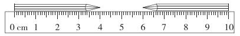

# Mathematics (Grade 6)

**ID**: b70508f9
**难度**: medium_hard
**题型**: multiple_choice

## 题目
图中两支铅笔，哪一支长？（）

A.左边的长
B.右边的长
C.一样长

## 解答

**答案**: C

1. Step1:观察图中左边铅笔，确定其笔尖对应的刻度是4cm，底部对应的刻度是0cm
2. Step2:计算左边铅笔的长度，用笔尖刻度减去底部刻度，即4 - 0 = 4cm
3. Step3:观察图中右边铅笔，确定其笔尖对应的刻度是10cm，底部对应的刻度是6cm
4. Step4:计算右边铅笔的长度，用笔尖刻度减去底部刻度，即10 - 6 = 4cm
5. Step5:比较两支铅笔的长度，因为4cm = 4cm，所以两支铅笔一样长

## 知识点

**知识点**:
  - 长度的测量;大小、多少、长短、轻重、高矮的比较

---
