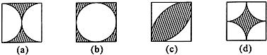

# Mathematics (Grade 6)

**ID**: b7675a8e
**难度**: medium_hard
**题型**: multiple_choice

## 题目
如图，下面4个正方形的边长都相等，共中阴影部分的面积相等的图形有（  ）

$\begin{description}
\item A．0个\item B．2个\item C．3个\item D．4个
\end{description}$

## 解答

**答案**: C

1. Step1:观察图形，明确四个正方形边长相等，所以四个正方形面积相等
2. Step2:分析图形（a），其空白部分可组成一个完整的圆
3. Step3:分析图形（b），其空白部分可组成一个完整的圆
4. Step4:分析图形（c），其空白部分不能组成一个完整的圆
5. Step5:分析图形（d），其空白部分可组成一个完整的圆
6. Step6:因为图形（a）、（b）、（d）中空白部分均可组成半径相等的完整的圆，且正方形面积相等，根据等量减去等量差相等的原理，可知（a）、（b）、（d）中阴影部分面积相等
7. Step7:确定阴影部分面积相等的图形有3个

## 知识点

**知识点**:
  - 面积及面积的大小比较；组合图形的面积．

---
