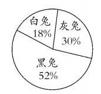

# Mathematics (Grade 6)

**ID**: ba20b579
**难度**: medium_hard
**题型**: multiple_choice

## 题目
如图是养兔专业户养的黑兔、灰兔、白兔的扇形统计图。 如果这个养兔专业户一共养兔250只，那么黑兔比白兔多养了（）只。

A.45
B.85
C.130

## 解答

**答案**: B

1. Step1:根据扇形统计图可知黑兔占总数的52%，白兔占总数的18%
2. Step2:计算黑兔与白兔占总数的百分比之差，即52% - 18% = 34%
3. Step3:已知养兔总数为250只，用总数乘以黑兔与白兔的百分比之差，即250×34% = 85只
4. Step4:得出黑兔比白兔多养了85只，答案选B

## 知识点

**知识点**:
  - 从统计图表中获取信息;百分数应用题

---
