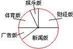

# Mathematics (Grade 6)

**ID**: bb91bf60
**难度**: medium_hard
**题型**: multiple_choice

## 题目
图是对一份杂志（共206页）各版块的统计结果，体育版约占（  ）页．
$\begin{description}
\item A．10\item B．30\item C．50\item D．100
\end{description}$

## 解答

**答案**: B

1. Step1:根据扇形统计图，估计财经版块约占整个杂志的四分之一，用杂志总页数206除以4，即206÷4≈51页，得到财经版块约占的页数。
2. Step2:由图可知财经版块的页数等于体育版块的页数与娱乐版块的页数之和。
3. Step3:因为体育版块比财经版块的页数少，又比娱乐版块占的页数多，结合选项，判断体育版块约占30页。

## 知识点

**知识点**:
  - 扇形统计图；从统计图表中获取信息．

---
