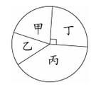

# Mathematics (Grade 6)

**ID**: bcfdccb3
**难度**: medium_hard
**题型**: multiple_choice

## 题目
如图，如果整个圆表示总体，那么代表总体的25%的扇形是（）。

A.甲
B.乙
C.丙
D.丁

## 解答

**答案**: D

1. Step1:观察图形，发现扇形丁对应的圆心角是直角
2. Step2:根据圆心角为直角，得出扇形丁占整个圆的1/4
3. Step3:根据分数与百分数的关系，将1/4化成25%
4. Step4:得出代表总体的25%的扇形是丁，答案选D

## 知识点

**知识点**:
  - 扇形统计图的认识及绘制

---
