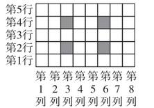

# Mathematics (Grade 6)

**ID**: befcbc01
**难度**: medium_hard
**题型**: multiple_choice

## 题目
小丽家的厨房的一面墙上贴着瓷砖，用数对表示下图第4行右边的深色瓷砖的位置为（）。

A.（3，2）
B.（3，4）
C.（6，4）

## 解答

**答案**: C

1. Step1:明确数对的意义，数对中前一个数表示列，后一个数表示行
2. Step2:观察图形，确定第4行右边的深色瓷砖所在列数为第6列
3. Step3:观察图形，确定第4行右边的深色瓷砖所在行数为第4行
4. Step4:根据数对表示方法，得出该瓷砖位置用数对表示为（6，4）
5. Step5:对比选项，答案为C

## 知识点

**知识点**:
  - 用数对确定位置

---
