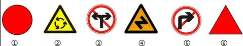

# Mathematics (Grade 6)

**ID**: bf2c1c61
**难度**: medium_hard
**题型**: multiple_choice

## 题目
(2011•云阳县)下列交通标志图中，是轴对称图形的有(  )

A．②③④
B．①⑤③⑥
C．①②③④⑥
D．①⑥

## 解答

**答案**: D

1. Step1:明确轴对称图形的定义为如果一个图形沿着一条直线对折后两部分完全重合，这样的图形叫做轴对称图形，这条直线叫做对称轴
2. Step2:分析图①，沿着过圆心的直线对折后两部分完全重合，是轴对称图形
3. Step3:分析图②，无论沿哪条直线对折，两部分都不能完全重合，不是轴对称图形
4. Step4:分析图③，无论沿哪条直线对折，两部分都不能完全重合，不是轴对称图形
5. Step5:分析图④，无论沿哪条直线对折，两部分都不能完全重合，不是轴对称图形
6. Step6:分析图⑤，无论沿哪条直线对折，两部分都不能完全重合，不是轴对称图形
7. Step7:分析图⑥，沿着底边高所在直线对折后两部分完全重合，是轴对称图形
8. Step8:得出是轴对称图形的有①⑥，所以答案选D

## 知识点

**知识点**:
  - 轴对称图形的辨识．

---
