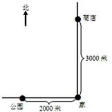

# Mathematics (Grade 6)

**ID**: bf5c1eed
**难度**: medium_hard
**题型**: multiple_choice

## 题目
小明从家出发向北走，走了37分钟，每分钟走76米．他走到了______；小敏从家出发向西走，走了30分钟，每分钟走72米，他走到了______．
A．商店的南面，公园的东面   B．商店的北面，公园的西面  
C．商店的南面，公园的西面   D．商店的北面，公园的东面．

## 解答

**答案**: C

1. Step1:根据公式路程=速度×时间，计算小明走的路程，即37×76=2812米
2. Step2:根据公式路程=速度×时间，计算小敏走的路程，即30×72=2160米
3. Step3:对比小明走的路程2812米和家到商店的距离3000米，2812＜3000，所以小明走到了商店的南面
4. Step4:对比小敏走的路程2160米和家到公园的距离2000米，2160＞2000，所以小敏走到了公园的西面
5. Step5:根据前面的判断，得出答案为C

## 知识点

**知识点**:
  - 方向．

---
