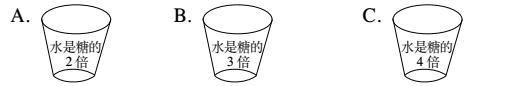

# Mathematics (Grade 6)

**ID**: c07a7154
**难度**: medium_hard
**题型**: multiple_choice

## 题目
下面三杯水里都放了同样的一匙糖，（）杯水最甜。

## 解答

**答案**: A

1. Step1:假设糖的量为1
2. Step2:根据条件计算选项A中水的量为1×2 = 2
3. Step3:根据条件计算选项B中水的量为1×3 = 3
4. Step4:根据条件计算选项C中水的量为1×4 = 4
5. Step5:比较三杯水中水的量，4＞3＞2
6. Step6:因为水越少，水越甜，所以得出选项A的水最甜
7. Step7:确定答案为A

## 知识点

**知识点**:
  - 乘法口诀

---
