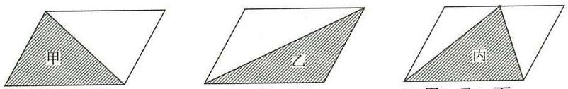

# Mathematics (Grade 6)

**ID**: c0dfdff3
**难度**: medium_hard
**题型**: multiple_choice

## 题目
下面3个图形是完全一样的平行四边形，涂色部分面积大小比较的结果是（   ）．

   A．甲=乙=丙  B．乙＞甲＞丙  C．甲＞乙＞丙

## 解答

**答案**: A

1. Step1:明确三个图形是完全一样的平行四边形
2. Step2:观察发现涂色部分均为三角形
3. Step3:由于平行四边形一样，可知三个三角形的高都等于平行四边形的高，即高相同
4. Step4:再观察可得三个三角形的底都等于平行四边形的底，即底相同
5. Step5:根据三角形面积公式S = 1/2×底×高，因为底和高都相同，所以三个三角形面积相同
6. Step6:得出甲=乙=丙，答案选A

## 知识点

**知识点**:
  - 多边形的面积-三角形的面积
-

---
