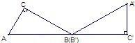

# Mathematics (Grade 6)

**ID**: c2649d37
**难度**: medium_hard
**题型**: multiple_choice

## 题目
在△ABC中，∠C=90°，∠A=60°，∠B=30°，AB=2，将△ABC绕点B旋转至△A′B′C′的位置（如图），且使点A、B、C′在同一条直线上，则点A经过的路径长为（  ）
A．$\frac{3}{5}$π
B．$\frac{4}{3}$π
C．$\frac{5}{6}$π
D．$\frac{5}{3}$π

## 解答

**答案**: D

1. Step1:确定点A经过的路径是以B为圆心，AB长为半径的弧
2. Step2:计算旋转的度数，因为∠ABC = 30°，点A、B、C′在同一条直线上，所以旋转度数为180 - 30 = 150°
3. Step3:根据圆的周长公式C = 2πr（r为半径），这里半径r = AB = 2，可得圆的周长为2×π×2
4. Step4:根据弧长公式l = 圆的周长×(旋转角度÷360)，计算点A经过的路径长为2×π×2×(150÷360) = $\frac{5}{3}$π

## 知识点

**知识点**:
  - 圆、圆环的周长．

---
