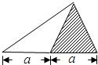

# Mathematics (Grade 6)

**ID**: c2d9b306
**难度**: medium_hard
**题型**: multiple_choice

## 题目
如图三角形中阴影部分和空白部分相比，（  ）

$\begin{description}
\item A．面积和周长都相等\item B．面积和周长都不相等\item C．周长相等面积不相等\item D．面积相等周长不相等
\end{description}$

## 解答

**答案**: D

1. Step1:观察图形可知，空白部分和阴影部分的底均为a，高是同一个三角形的高，即等底等高。
2. Step2:根据等底等高的三角形面积相等这一性质，可得空白部分和阴影部分面积相等。
3. Step3:分析两个三角形的边，它们有一条公共边，对应的底边都为a相等，而另外一条边不相等。
4. Step4:根据三角形周长为三条边长度之和，由于有一条边不相等，所以两个三角形周长不相等。
5. Step5:综上，空白部分和阴影部分面积相等周长不相等，答案选D。

## 知识点

**知识点**:
  - 面积及面积的大小比较．

---
