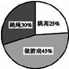

# Mathematics (Grade 6)

**ID**: c2e0058b
**难度**: medium_hard
**题型**: multiple_choice

## 题目
如图是某校六年级一班40名同学课外活动时喜欢的体育运动扇形统计图，那么喜欢做游戏的同学有（  ）人．
$\begin{description}
\item A．45\%\item B．45\item C．18
\end{description}$

## 解答

**答案**: C

1. Step1:明确题目给出了六年级一班总人数为40人，以及喜欢做游戏的同学占比为45%
2. Step2:根据“求一个数的百分之几是多少用乘法”的方法，列出算式40×45%
3. Step3:计算40×45%的结果为18
4. Step4:得出喜欢做游戏的同学有18人，所以答案选C

## 知识点

**知识点**:
  - 扇形统计图．

---
