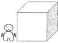

# Mathematics (Grade 6)

**ID**: c478a15a
**难度**: medium_hard
**题型**: multiple_choice

## 题目
如图，欢欢身高1m，在儿童乐园中有一个正方体大型玩具屋，试估计这个大型玩具屋的体积是（  ）

$\begin{description}
\item A．8m^{3}\item B．16m^{3}\item C．27m^{3}\item D．64m^{3}
\end{description}$

## 解答

**答案**: A

1. Step1:根据图意可知欢欢身高1米，且约占正方体棱长的一半
2. Step2:由此计算正方体的棱长为1×2 = 2米
3. Step3:根据正方体体积公式v = a³，这里a = 2米，所以体积为2×2×2 = 8立方米
4. Step4:对比选项，发现8立方米对应的是选项A，所以答案是A

## 知识点

**知识点**:
  - 估测．

---
