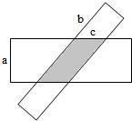

# Mathematics (Grade 6)

**ID**: c4c2baf4
**难度**: medium_hard
**题型**: multiple_choice

## 题目
如图，两张长度相等的长方形重叠在一起，阴影部分的面积是（  ）

A．ab
B．bc
C．ac
D．c^{2}

## 解答

**答案**: C

1. Step1:观察图形可知，重叠部分为平行四边形
2. Step2:明确平行四边形的底为c
3. Step3:明确平行四边形的高为a
4. Step4:根据平行四边形面积公式S = 底×高，可得面积为a×c = ac
5. Step5:对比选项，得出答案为C

## 知识点

**知识点**:
  - 重叠问题．

---
