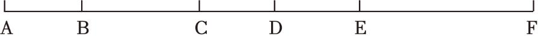

# Mathematics (Grade 6)

**ID**: c73c964b
**难度**: medium_hard
**题型**: multiple_choice

## 题目
用下面的线段AF围成一个圆，得到的圆的直径约与（    ）相当。 

A.线段AB
B.线段AD
C.线段AE
D.线段CE

## 解答

**答案**: D

1. Step1:明确用线段AF围成圆时，圆的周长等于线段AF的长度
2. Step2:根据圆的周长公式C＝πd，推出圆的直径d＝C÷π
3. Step3:假设线段AF长约10cm，计算圆的直径约为10÷3.14≈3（cm）
4. Step4:测量线段AB长约1.5cm，判断不符合题意
5. Step5:测量线段AD长约5cm，判断不符合题意
6. Step6:测量线段AE长约6.5cm，判断不符合题意
7. Step7:测量线段CE长约3cm，判断符合题意

## 知识点

**知识点**:
  - 

---
