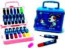

# Mathematics (Grade 6)

**ID**: c748286a
**难度**: medium_hard
**题型**: multiple_choice

## 题目
学校买324盒水彩笔，每盒有12枝，发给绘画比赛中获奖的36名同学，平均每位同学得到（  ）枝水彩笔．

$\begin{description}
\item A．108\item B．9\item C．21
\end{description}$

## 解答

**答案**: A

1. Step1:根据题目，先计算水彩笔的总枝数，因为有324盒水彩笔，每盒12枝，所以总枝数为324×12=3888枝
2. Step2:已知要将这些水彩笔发给36名同学，用总枝数除以同学的人数，即3888÷36
3. Step3:计算3888÷36的结果为108枝，所以平均每位同学得到108枝水彩笔，答案选A

## 知识点

**知识点**:
  - 平均数的含义及求平均数的方法．

---
