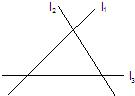

# Mathematics (Grade 6)

**ID**: c88078b8
**难度**: medium_hard
**题型**: multiple_choice

## 题目
图中对顶角有（  ）对．

$\begin{description}
\item A．3\item B．4\item C．5\item D．6
\end{description}$

## 解答

**答案**: D

1. Step1:明确对顶角的定义，即如果一个角的两边分别是另一个角两边的反向延长线，且这两个角有公共顶点，那么这两个角是对顶角
2. Step2:观察图形，确定直线L₁、L₂、L₃共有三个交点
3. Step3:因为每一个交点处有2对对顶角
4. Step4:计算对顶角的总数，通过3×2=6对
5. Step5:对比选项，得出答案为D

## 知识点

**知识点**:
  - 角的概念及其分类．

---
