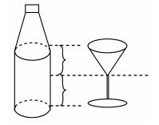

# Mathematics (Grade 6)

**ID**: ccb3e77a
**难度**: medium_hard
**题型**: multiple_choice

## 题目
如图中，瓶底的面积和锥形杯口的面积相等，将瓶中的液体倒入锥形杯子中，能倒满（）杯。

A.2
B.3
C.6

## 解答

**答案**: C

1. Step1:设杯子的高度是h，瓶底的面积是s
2. Step2:根据圆柱体积公式，计算圆柱形瓶内水的体积为S×2h=2Sh
3. Step3:根据圆锥体积公式，计算圆锥形杯子的体积为$rac{1}{3}$×S×h=$rac{1}{3}$Sh
4. Step4:用圆柱形瓶内水的体积除以圆锥形杯子的体积，即2Sh÷$rac{1}{3}$Sh = 2×3 = 6（杯）
5. Step5:得出能倒满6杯，答案选C

## 知识点

**知识点**:
  - 圆柱的体积;圆锥的体积

---
