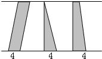

# Mathematics (Grade 6)

**ID**: ccd21494
**难度**: medium_hard
**题型**: multiple_choice

## 题目
如图平行线间三个图形面积比较，(  )

A．平行四边形面积最大
B．三角形的面积最大
C．梯形的面积最大

## 解答

**答案**: A

1. Step1:设三个图形的高都是h，梯形的上底是a
2. Step2:根据三角形面积公式，计算三角形的面积为4h÷2=2h
3. Step3:根据平行四边形面积公式，计算平行四边形的面积为4h
4. Step4:根据梯形面积公式，计算梯形的面积为(a + 4)h÷2=0.5ah + 2h
5. Step5:因为a＜4，所以0.5ah＜2h
6. Step6:由0.5ah＜2h推出0.5ah + 2h＜4h，且2h＜4h
7. Step7:得出平行四边形的面积最大，答案选A

## 知识点

**知识点**:
  - 面积及面积的大小比较;平行四边形的面积;三角形的周长和面积;梯形的面积．

---
