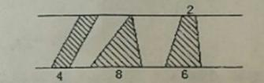

# Mathematics (Grade 6)

**ID**: cddf7f3d
**难度**: medium_hard
**题型**: multiple_choice

## 题目

 2 4 8 6
 在上图中，平行线间的三个图形，它们的面积相比（ ）
 A．平行四边形的面积大
 B．三角形的面积大
 C．梯形的面积大
 D．面积都相等

## 解答

**答案**: D

1. Step1:设三个图形的高都为h
2. Step2:根据平行四边形面积公式，计算平行四边形面积为4×h = 4h
3. Step3:根据三角形面积公式，计算三角形面积为8×h÷2 = 4h
4. Step4:根据梯形面积公式，计算梯形面积为(2 + 6)×h÷2 = 4h
5. Step5:比较三个图形面积，发现都为4h，所以面积都相等，答案选D

## 知识点

**知识点**:
  - --

---
