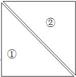

# Mathematics (Grade 6)

**ID**: cdf91b45
**难度**: medium_hard
**题型**: multiple_choice

## 题目
如图两图形的周长（  ）
$\begin{description}
\item A．①长\item B．②长\item C．一样长
\end{description}$

## 解答

**答案**: C

1. Step1:明确①的周长组成是2个正方形的边长加上正方形的对角线的长
2. Step2:明确②的周长组成是2个正方形的边长加上正方形的对角线的长
3. Step3:对比①和②的周长组成，发现两者相同，得出①的周长等于②的周长
4. Step4:根据选项，选择C

## 知识点

**知识点**:
  - 三角形的周长和面积．

---
