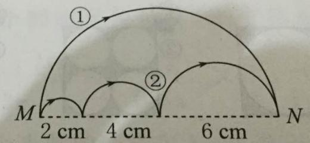

# Mathematics (Grade 6)

**ID**: d11302d2
**难度**: medium_hard
**题型**: multiple_choice

## 题目
如图，从M到N有两条路，路①的长度与路②相比，（    ）

 2cm，4cm，6cm
 A.路①长
 B.路②长
 C.一样长

## 解答

**答案**: C

1. Step1:计算路①所在大半圆的直径为2 + 4 + 6 = 12cm
2. Step2:根据圆的周长公式C = πd，路①的长度为3.14×12÷2×2 = 37.68cm（因为是半圆，最后乘2是来回的长度，这里假设走一个来回方便和路②对比）
3. Step3:计算路②中三个小半圆的直径分别为2cm、4cm、6cm
4. Step4:分别计算路②中三个小半圆的长度，根据圆的周长公式C = πd，第一个小半圆长度为3.14×2÷2×2 = 6.28cm，第二个小半圆长度为3.14×4÷2×2 = 12.56cm，第三个小半圆长度为3.14×6÷2×2 = 18.84cm
5. Step5:计算路②的总长度为6.28 + 12.56 + 18.84 = 37.68cm
6. Step6:比较路①和路②的长度，发现两者均为37.68cm，得出两条路一样长

## 知识点

**知识点**:
  - --

---
