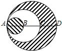

# Mathematics (Grade 6)

**ID**: d2787947
**难度**: medium_hard
**题型**: multiple_choice

## 题目
如图，AB=BC=CD，其中阴影部分面积和空白部分面积的比是（  ）

$\begin{description}
\item A．2：1\item B．1：2\item C．5：4\item D．4：5
\end{description}$

## 解答

**答案**: A

1. Step1:设AB=BC=CD=2
2. Step2:计算最小圆的半径为2÷2=1
3. Step3:根据圆的面积公式S = πr²，计算最小圆的面积为π×1² = π
4. Step4:计算中间圆的半径为2
5. Step5:计算中间圆的面积为π×2² = 4π
6. Step6:计算空白部分面积为4π - π = 3π
7. Step7:计算最大圆的半径为(2×3)÷2 = 3
8. Step8:计算最大圆的面积为π×3² = 9π
9. Step9:计算外面阴影部分面积为9π - 4π = 5π
10. Step10:计算阴影部分总面积为π + 5π = 6π
11. Step11:计算阴影部分面积和空白部分面积比为6π : 3π = 2 : 1

## 知识点

**知识点**:
  - 比的意义；圆、圆环的面积．

---
