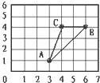

# Mathematics (Grade 6)

**ID**: d297b3e7
**难度**: medium_hard
**题型**: multiple_choice

## 题目
如图：△ABC，则顶点B 的位置用数对表示为（  ）

$\begin{description}
\item A．（3，1）\item B．（1，1）\item C．（6，4）\item D．（4，4）
\end{description}$

## 解答

**答案**: C

1. Step1:明确数对表示位置的方法为第一个数字表示列，第二个数字表示行
2. Step2:观察图中顶点B所在的列是第6列
3. Step3:观察图中顶点B所在的行是第4行
4. Step4:根据数对表示位置的方法，得出顶点B的位置用数对表示为（6，4）
5. Step5:对比选项，确定答案为C

## 知识点

**知识点**:
  - 数对与位置．

---
