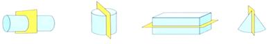

# Mathematics (Grade 6)

**ID**: d3186b6d
**难度**: medium_hard
**题型**: multiple_choice

## 题目
下面图形中，（   ）图形的切面是等腰三角形。

$\begin{description}
\item A．圆柱\item B．长方体\item C．圆锥\item D．无法确定
\end{description}$

## 解答

**答案**: C

1. Step1:分析选项A，圆柱的切面常见的有圆形、长方形等，不会是等腰三角形
2. Step2:分析选项B，长方体的切面常见的有长方形、正方形等，不会是等腰三角形
3. Step3:分析选项C，圆锥沿着高切开，其切面是等腰三角形
4. Step4:综合以上分析，可知圆锥的切面是等腰三角形，答案为C

## 知识点

**知识点**:
  - 

---
