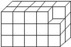

# Mathematics (Grade 6)

**ID**: d367fb70
**难度**: medium_hard
**题型**: multiple_choice

## 题目
从一个体积是30立方厘米的长方体木块中，挖掉一小块后（如图），它的表面积（   ）。

$\begin{description}
\item A．和原来同样大\item B．比原来小\item C．比原来大\item D．无法判断
\end{description}$

## 解答

**答案**: A

1. Step1:观察图形可知是从长方体木块的顶点处挖掉一小块
2. Step2:分析顶点处挖掉一小块的情况，发现减少的面与增加的面个数均为3个
3. Step3:根据表面积的定义，由于减少和增加的面数量相同，所以长方体的表面积没发生变化
4. Step4:对比选项，得出答案为A

## 知识点

**知识点**:
  - 

---
