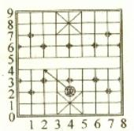

# Mathematics (Grade 6)

**ID**: d520b86a
**难度**: medium_hard
**题型**: multiple_choice

## 题目
按照中国象棋的规则，“马走日，象走田”，现在“象”将要按照如图所示的方向继续走动，那么下一步将要到达的位置是（）

A.（4,2）
B.（2,4）
C.（4,4）

## 解答

**答案**: B

1. Step1:明确中国象棋中“象走田”的规则以及数对表示位置的方法，数对中第一个数表示列，第二个数表示行
2. Step2:观察图示中“象”的走动方向
3. Step3:根据“象走田”规则和图示方向，判断“象”下一步到达的位置是第二列、第四行
4. Step4:根据数对表示位置的方法，第二列、第四行用数对表示为（2,4）
5. Step5:对比选项，得出答案为B

## 知识点

**知识点**:
  - 用数对确定位置

---
