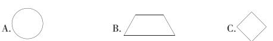

# Mathematics (Grade 6)

**ID**: d694a857
**难度**: medium_hard
**题型**: multiple_choice

## 题目
下面第（）个图形不能密舖平面。

## 解答

**答案**: A

1. Step1:分析选项A，圆的一周是光滑的曲面，不满足密铺条件，不能密铺平面
2. Step2:分析选项B，相同的4个梯形的4个内角可以围成360°的角，满足密铺条件，能密铺平面
3. Step3:分析选项C，正方形每个内角是90°，90°能整除360°，满足密铺条件，能密铺平面
4. Step4:根据以上分析，得出不能密铺平面的图形是选项A

## 知识点

**知识点**:
  - 密铺

---
