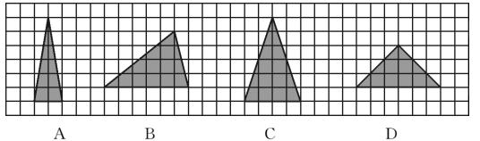

# Mathematics (Grade 6)

**ID**: d726b65d
**难度**: medium_hard
**题型**: multiple_choice

## 题目
下面三角形中，（）的底与高的比是3:2。

## 解答

**答案**: B

1. Step1:分析选项A，数格子得到其底是2，高是6，计算底与高的比为2:6，化简后为1:3，不符合要求
2. Step2:分析选项B，数格子得到其底是6，高是4，计算底与高的比为6:4，化简后为3:2，符合要求
3. Step3:分析选项C，数格子得到其底是4，高是6，计算底与高的比为4:6，化简后为2:3，不符合要求
4. Step4:分析选项D，数格子得到其底是6，高是3，计算底与高的比为6:3，化简后为2:1，不符合要求
5. Step5:综上，符合底与高的比是3:2的是选项B

## 知识点

**知识点**:
  - 

---
