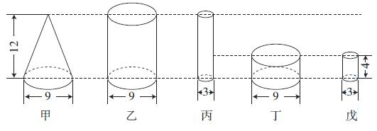

# Mathematics (Grade 6)

**ID**: d96947ca
**难度**: medium_hard
**题型**: multiple_choice

## 题目
观察下图，下列说法正确的是（   ）。

$\begin{description}
\item A．甲的体积与乙的体积比是3∶1\item B．丁的体积与甲的体积相等\item C．丙的体积是乙的\frac{1}{3}\item D．丁的体积是戊的3倍
\end{description}$

## 解答

**答案**: B

1. Step1:根据圆柱和圆锥的体积公式，分析选项A，甲是圆锥，乙是与甲等底等高的圆柱，圆锥体积公式为$V_1=rac{1}{3}\pi r^2h$，圆柱体积公式为$V_2=\pi r^2h$，所以甲的体积与乙的体积比是1∶3，A选项错误
2. Step2:分析选项B，甲是圆锥，丁是与甲等底面积且体积相等的圆柱，根据圆锥和圆柱体积公式，等体积等底面积的圆柱和圆锥，圆锥的高是圆柱高的3倍，所以丁的体积与甲的体积相等，B选项正确
3. Step3:分析选项C，乙和丙的高相同，乙的底面半径是9÷2 = 4.5，丙的底面半径是3÷2 = 1.5，根据圆柱体积公式$V=\pi r^2h$，丙的体积与乙的体积比为$(\pi×1.5^2h):(\pi×4.5^2h)=1:9$，即丙的体积是乙的$rac{1}{9}$，C选项错误
4. Step4:分析选项D，丁和戊的高相同，丁的底面半径是9÷2 = 4.5，戊的底面半径是3÷2 = 1.5，根据圆柱体积公式$V=\pi r^2h$，丁的体积与戊的体积比为$(\pi×4.5^2h):(\pi×1.5^2h)=9:1$，即丁的体积是戊的9倍，D选项错误

## 知识点

**知识点**:
  - 

---
