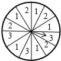

# Mathematics (Grade 6)

**ID**: d984506b
**难度**: medium_hard
**题型**: multiple_choice

## 题目

(2010•恭城县)如图，指针指在1与指在2的可能性比较(  )
A．指在1的大
B．指在2的大
C．一样大
D．无法确定

## 解答

**答案**: A

1. Step1:观察图形，确定整个圆被平均分成了12份
2. Step2:数出标“1”的份数为5份
3. Step3:数出标“2”的份数为4份
4. Step4:根据可能性求法，计算指针指在1的可能性为5÷12=$rac{5}{12}$
5. Step5:计算指针指在2的可能性为4÷12=$rac{4}{12}$
6. Step6:比较$rac{5}{12}$和$rac{4}{12}$的大小，得出$rac{5}{12}$＞$rac{4}{12}$
7. Step7:得出指在1的可能性比指在2的可能性大，答案选A

## 知识点

**知识点**:
  - 可能性的大小．

---
