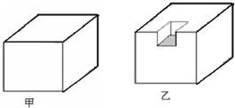

# Mathematics (Grade 6)

**ID**: da1c72d9
**难度**: medium_hard
**题型**: multiple_choice

## 题目
图中两个物体的表面积比较，结果是（  ）

$\begin{description}
\item A．甲＞乙\item B．甲＜乙\item C．甲=乙
\end{description}$

## 解答

**答案**: B

1. Step1:观察图形可知乙物体是从长方体甲一个宽处去掉了一个小正方体
2. Step2:分析去掉小正方体后的面的变化情况，发现减去2个面又增加了4个面
3. Step3:因为增加的面的数量多于减少的面的数量，所以乙物体的表面积增大
4. Step4:得出甲物体的表面积小于乙物体的表面积，即甲＜乙，答案选B

## 知识点

**知识点**:
  - 长方体和正方体的表面积．

---
