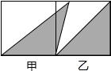

# Mathematics (Grade 6)

**ID**: da537338
**难度**: medium_hard
**题型**: multiple_choice

## 题目
如图，边长相等的两个正方形中，画了甲、乙两个三角形(用阴影表示)，它们的面积相比(  )
A．甲的面积大
B．乙的面积大
C．相等

## 解答

**答案**: C

1. Step1:观察图形可知，甲三角形的底是正方形的边长，高也是正方形的边长
2. Step2:观察图形可知，乙三角形的底是正方形的边长，高也是正方形的边长
3. Step3:由于两个正方形边长相等，所以甲、乙两个三角形的底和高分别相等
4. Step4:根据三角形面积公式S = 1/2×底×高，底和高分别相等的两个三角形面积相等，所以甲、乙两个三角形面积相等，答案选C

## 知识点

**知识点**:
  - 组合图形的面积．

---
