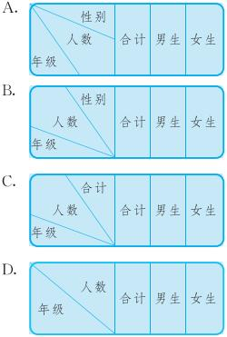

# Mathematics (Grade 6)

**ID**: da83695a
**难度**: medium_hard
**题型**: multiple_choice

## 题目
同学们要统计全校各年级男女生人数情况，下面表头设计中，（）较为合理。

## 解答

**答案**: B

1. Step1:明确任务是统计全校各年级男女生人数情况
2. Step2:分析可知统计项目应包含年级、性别、人数及合计
3. Step3:对比各选项表头，判断其是否包含所需统计项目
4. Step4:得出B选项表头包含年级、性别、人数、合计，符合统计需求，较为合理

## 知识点

**知识点**:
  - 简单的调查表设计

---
