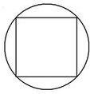

# Mathematics (Grade 6)

**ID**: dade56db
**难度**: medium_hard
**题型**: multiple_choice

## 题目
如图，已知正方形面积是4平方米，图中圆的面积是$\underline{\hspace{5em}}$平方米
A.12.56       B.3.14     C.6.28．

## 解答

**答案**: C

1. Step1:设正方形的对角线长为x米，因为正方形面积等于对角线×对角线÷2，已知正方形面积是4平方米，所以得出x×x÷2=4
2. Step2:由x×x÷2=4，求解可得x²=8
3. Step3:因为圆的直径等于正方形的对角线长x米，根据圆的面积公式S=π($\frac{x}{2}$²，将其变形为S = 3.14×$\frac{x²}{4}$
4. Step4:把x²=8代入S = 3.14×$\frac{x²}{4}$，可得S=3.14×$\frac{8}{4}$=6.28平方米
5. Step5:对比选项，答案为C

## 知识点

**知识点**:
  - 组合图形的面积．

---
