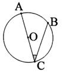

# Mathematics (Grade 6)

**ID**: dbf18bbd
**难度**: medium_hard
**题型**: multiple_choice

## 题目
下面说法中，正确的有（   ）个。
（1）$\frac{7}{100}$千米可以写成$7%$千米。
（2）大牛和小牛的头数比是$4:5$，表示大牛比小牛少$\frac{1}{5}$。
（3）下图中$\angle ACB$是圆心角。

（4）打同一篇稿件，小强用了10分钟，小玲用了12分钟，小强和小玲的打字速度之比是$6:5$。
A．1
B．2
C．3
D．4

## 解答

**答案**: B

1. Step1:分析（1），百分数表示一个数是另一个数的百分之几，是一个分率，后面不能带单位，所以$\frac{7}{100}$千米不可以写成$7\%$千米，（1）错误
2. Step2:分析（2），大牛和小牛的头数比是$4:5$，把大牛的头数看成4份，小牛的头数看成5份，那么大牛比小牛少$5 - 4\div5=\frac{1}{5}$，（2）正确
3. Step3:分析（3），圆心角是顶点在圆心的角，图中$\angle ACB$顶点不在圆心，不是圆心角，（3）错误
4. Step4:分析（4），把这篇稿件的工作量看成单位“1”，小强的打字速度是$\frac{1}{10}$，小玲的打字速度是$\frac{1}{12}$，小强和小玲的打字速度之比是$\frac{1}{10}:\frac{1}{12}=6:5$，（4）正确
5. Step5:综上，（2）（4）正确，正确的有2个

## 知识点

**知识点**:
  - 小学数学;数与代数;数的认识;百分数的认识;比和比例;比;比的意义

---
