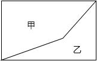

# Mathematics (Grade 6)

**ID**: dd4687ce
**难度**: medium_hard
**题型**: multiple_choice

## 题目

(2012•龙山县)如图中，甲、乙两部分的周长相比较，甲的周长(  )乙的周长．
A．大于
B．小于
C．等于

## 解答

**答案**: C

1. Step1:明确甲的周长组成，为长方形的长、宽以及公共曲线边长之和
2. Step2:明确乙的周长组成，为长方形的长、宽以及公共曲线边长之和
3. Step3:对比甲和乙的周长组成，发现二者相同，所以得出甲的周长等于乙的周长，答案选C

## 知识点

**知识点**:
  - 长方形的特征及性质．

---
