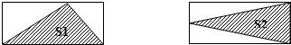

# Mathematics (Grade 6)

**ID**: df44fb6b
**难度**: medium_hard
**题型**: multiple_choice

## 题目
两个面积相等的长方形(如图)，比较两个阴影部分面积的大小(  )

A．$S_{1}$＞$S_{2}$
B．$S_{2}$＞$S_{1}$
C．$S_{1}=S_{2}$

## 解答

**答案**: C

1. Step1:分析第一个图形，可知阴影部分$S_{1}$的面积是其所在长方形面积的一半
2. Step2:分析第二个图形，可知阴影部分$S_{2}$的面积是其所在长方形面积的一半
3. Step3:因为两个长方形面积相等，所以$S_{1}$和$S_{2}$都等于同一个面积的一半，即$S_{1}=S_{2}$，故答案选C

## 知识点

**知识点**:
  - 面积及面积的大小比较．

---
