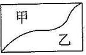

# Mathematics (Grade 6)

**ID**: df647f3b
**难度**: medium_hard
**题型**: multiple_choice

## 题目
如图
   

   ，甲和乙的周长相比较，（  ）
   A．甲＞乙
   B．甲＜乙
   C．甲＝乙

## 解答

**答案**: C

1. Step1:明确甲的周长组成，为长方形的长+宽+公共曲线边长
2. Step2:明确乙的周长组成，为长方形的长+宽+公共曲线边长
3. Step3:对比甲和乙的周长组成，发现二者相同，所以得出甲的周长=乙的周长
4. Step4:根据选项，选择答案C

## 知识点

**知识点**:
  - 总复习-期末综合测试
-

---
