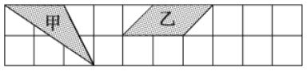

# Mathematics (Grade 6)

**ID**: e1e0c4a5
**难度**: medium_hard
**题型**: multiple_choice

## 题目
下图中，甲和乙两部分面积的关系是（）。

A．甲=乙
B．甲＞乙
C．甲＜乙

## 解答

**答案**: A

1. Step1:设每个小正方形的边长为1
2. Step2:计算甲（三角形）的面积，根据三角形面积公式S = 底×高÷2，底为2，高为2，可得S甲 = 2×2÷2 = 2
3. Step3:计算乙（平行四边形）的面积，根据平行四边形面积公式S = 底×高，底为2，高为1，可得S乙 = 2×1 = 2
4. Step4:比较甲和乙的面积，因为S甲 = 2，S乙 = 2，所以S甲 = S乙，即甲=乙
5. Step5:根据比较结果，从选项中选择答案为A

## 知识点

**知识点**:
  - 三角形的面积;平行四边形的面积

---
