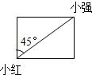

# Mathematics (Grade 6)

**ID**: e2ef1a9d
**难度**: medium_hard
**题型**: multiple_choice

## 题目
小红看小强在北偏东45°的方向上，小强看小红在(  )方向上．
A．西偏南45°
B．东偏南45°
C．北偏西45°

## 解答

**答案**: A

1. Step1:明确物体位置具有相对性，存在北对南、西对东、东南对西北，东北对西南的关系
2. Step2:已知小红看小强在北偏东45°的方向上，根据北对南、东对西以及角度不变的原则
3. Step3:得出小强看小红在南偏西45°方向上，南偏西45°也可表述为西偏南45°
4. Step4:对比选项，确定答案为A

## 知识点

**知识点**:
  - 根据方向和距离确定物体的位置．

---
